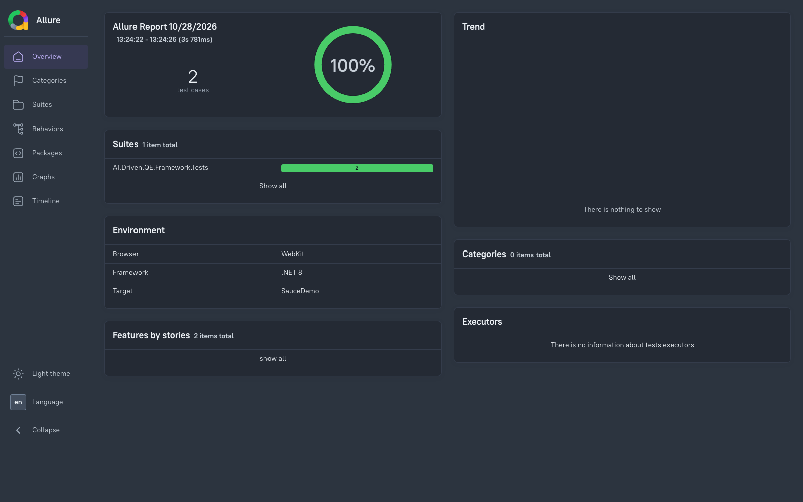
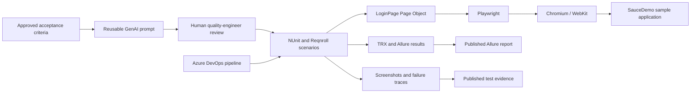

# AI-Accelerated Quality Engineering Blueprint

🚀 A client-demo POC showing how browser automation, risk-based test design, CI/CD, and human-reviewed GenAI assistance can work together in a quality engineering workflow.

> **POC scope:** This repository exercises the public SauceDemo sample application. It demonstrates an approach, not measured customer time savings or a production-ready test platform. Adapt the URL, selectors, data, and controls before using it with a client application.

## Why this approach

Legacy regression cycles can delay feedback and releases. This blueprint demonstrates a shift of repeatable checks into browser automation, with CI feedback and reusable test-design prompts to help teams review quality risks earlier.

The POC demonstrates:

- ✅ Repeatable login and checkout checks in Chromium and WebKit.
- ⚡ CI feedback with TRX results and Allure reports.
- 🔎 Per-test screenshots, plus Playwright traces on failures, to speed up triage.
- 🧠 A reusable GenAI prompt for drafting scenarios, with explicit human review and no runtime AI dependency.

No time-to-market or coverage improvement is claimed as a measured result; quantify those outcomes against a client baseline during a pilot.

### Sample report

The committed snapshot below shows the Allure report for the passing SauceDemo scenarios. Each CI browser job publishes its own report and evidence artifacts.



## Tech stack

| Technology | Role |
|---|---|
| C# / .NET 8 | Test implementation and shared framework utilities |
| Microsoft Playwright | Browser automation and trace capture |
| NUnit + Reqnroll | NUnit execution with readable Gherkin BDD scenarios |
| Azure DevOps Pipelines | CI/CD and browser-matrix execution |
| Allure | Test reports, metadata, and evidence attachments |
| GenAI prompt | Human-reviewed candidate test-scenario design |

## Architecture



### Design highlights

- **Page Object Model:** [LoginPage.cs](./tests/pages/LoginPage.cs) keeps SauceDemo navigation and login selectors out of test assertions.
- **Purchase journey:** Product, cart, and checkout interactions live in dedicated [ProductsPage.cs](./tests/pages/ProductsPage.cs), [CartPage.cs](./tests/pages/CartPage.cs), and [CheckoutPage.cs](./tests/pages/CheckoutPage.cs) page objects.
- **Test settings:** [TestSettings.cs](./utils/TestSettings.cs) centralizes browser selection, artifact output, and safe filenames.
- **Risk-focused examples:** [LoginTests.cs](./tests/LoginTests.cs) covers successful sign-in, a locked-out user, and the end-to-end add-to-cart and checkout flow.
- **Behavior-driven development:** [Login.feature](./tests/Features/Login.feature) expresses the same customer journeys in Gherkin. Reqnroll bindings are organized under `StepDefinitions/` and browser lifecycle hooks under `Hooks/`; both reuse the existing Page Objects and NUnit test runner.
- **AI-assisted planning:** [login-scenario-generation.md](./ai-prompts/login-scenario-generation.md) includes a reusable prompt, illustrative scenarios, and a review checklist. It does not call an AI service or generate code in CI.
- **Failure diagnostics:** Each test attaches a screenshot to NUnit/Allure results. Failed tests also save a Playwright trace ZIP for Trace Viewer.

## Repository structure

```text
ai-prompts/
  login-scenario-generation.md   # Reusable, human-reviewed scenario prompt
docs/
  assets/
    allure-demo.png              # Sample Allure report screenshot
pipelines/
  azure-pipelines.yml            # Build, cross-browser tests, reports, artifacts
.github/
  workflows/
    quality.yml                  # GitHub Actions build and browser matrix
  dependabot.yml                 # Weekly GitHub Actions and NuGet update PRs
tests/
  AI.Driven.QE.Framework.Tests.csproj
  pages/
    LoginPage.cs                 # SauceDemo Page Object
    ProductsPage.cs
    CartPage.cs
    CheckoutPage.cs
  Features/
    Login.feature                 # Gherkin acceptance scenarios
  StepDefinitions/
    LoginSteps.cs                 # Reqnroll step bindings
  Hooks/
    PlaywrightHooks.cs            # Per-scenario browser lifecycle and evidence
  LoginTests.cs                   # NUnit tests
  allureConfig.json
utils/
  TestSettings.cs                # Browser and evidence settings
```

## Run locally

### Prerequisites

- .NET 8 SDK and runtime
- PowerShell (`pwsh`) for Playwright's browser installer
- Internet access to SauceDemo
- Node.js/npm and Java 17+ if generating an Allure HTML report locally

Clone the repository and restore/build the test project:

```bash
git clone https://github.com/aeromodeller/AI-Driven-QE-Framework.git
cd AI-Driven-QE-Framework
dotnet restore tests/AI.Driven.QE.Framework.Tests.csproj
dotnet build tests/AI.Driven.QE.Framework.Tests.csproj --configuration Release
```

Install Chromium for the default local run:

```bash
pwsh tests/bin/Release/net8.0/playwright.ps1 install chromium
```

The test defaults target the public SauceDemo sample. For a client environment, configure the login URL and credentials through environment variables; never commit client secrets:

```bash
export QE_LOGIN_URL="https://your-authorized-test-environment.example/login"
export QE_USERNAME="your-approved-test-user"
export QE_PASSWORD="your-secret-test-password"
export QE_LOCKED_OUT_USERNAME="your-approved-locked-out-user"
```

Unset variables use the public SauceDemo defaults. The locked-out assertion and page objects currently reflect SauceDemo behavior and must be adapted for a different application.

Run the suite and save screenshots under the repository's `test-artifacts/` directory:

```bash
export QE_ARTIFACTS_DIR="$PWD/test-artifacts"
dotnet test tests/AI.Driven.QE.Framework.Tests.csproj --configuration Release
```

The test command runs both the existing NUnit tests and the Reqnroll scenarios generated from `.feature` files. Add acceptance criteria to `tests/Features/` and implement their bindings in `tests/StepDefinitions/`; shared browser lifecycle hooks belong in `tests/Hooks/`. The BDD scenarios reuse the Page Objects in `tests/pages/`.

To run WebKit locally, install it and select it through `PLAYWRIGHT_BROWSER`:

```bash
pwsh tests/bin/Release/net8.0/playwright.ps1 install webkit
PLAYWRIGHT_BROWSER=webkit dotnet test tests/AI.Driven.QE.Framework.Tests.csproj --configuration Release
```

The suite uses SauceDemo's public demonstration accounts by default: `standard_user` and `locked_out_user`, both with the demo password `secret_sauce`. Do not reuse these credentials for other systems. The success test verifies the Products inventory route; the negative test checks the locked-out error; the checkout test adds the Sauce Labs Backpack and completes the demo order.

### View reports and failure evidence

The NUnit/Allure results are written under `tests/bin/Release/net8.0/allure-results`. Generate an HTML report after running tests:

```bash
npm install --global allure-commandline@2.46.1
allure generate tests/bin/Release/net8.0/allure-results --clean --output allure-report
allure open allure-report
```

Screenshots are saved to `test-artifacts/` locally and attached to the test results. Failed tests also save a `*-trace.zip`; open it with Playwright's Trace Viewer:

```bash
pwsh tests/bin/Release/net8.0/playwright.ps1 show-trace test-artifacts/<test-name>-chromium-trace.zip
```

## Azure DevOps

Create a pipeline using [azure-pipelines.yml](./pipelines/azure-pipelines.yml). It builds the .NET 8 test project and runs a Chromium/WebKit matrix. Each browser job publishes:

- NUnit TRX test results.
- Raw Allure results and a generated HTML Allure report.
- Per-test screenshots and failure traces.

The pipeline pins agents to Ubuntu 24.04 because the current Playwright version does not support the newer Ubuntu 26.04 hosted image. You can optionally set `QE_LOGIN_URL`, `QE_USERNAME`, `QE_PASSWORD`, and `QE_LOCKED_OUT_USERNAME` as pipeline variables; mark `QE_PASSWORD` secret. Validate the YAML and permissions in your Azure DevOps organization before the client demo. The sample target is an external public demo site, so results depend on its availability and network access.

## GitHub Actions

The workflow at [quality.yml](./.github/workflows/quality.yml) runs on pushes and pull requests targeting `main`, and can also be started manually with `workflow_dispatch`. It builds the test project on Ubuntu 24.04, then runs the Chromium/WebKit matrix on the same supported image. NuGet packages are cached between runs; install and test durations are recorded in each job summary. The PR checks show a per-browser test summary with a link to that run's artifacts. Each matrix job publishes TRX results, raw Allure results, a generated Allure HTML report, and screenshots/failure traces as downloadable artifacts retained for 14 days.

The sample SauceDemo accounts need no repository secrets. To target a client environment, configure the `QE_LOGIN_URL` repository variable and `QE_USERNAME`, `QE_PASSWORD`, and `QE_LOCKED_OUT_USERNAME` repository secrets. Client credentials are passed only to the test process. [Dependabot](./.github/dependabot.yml) checks GitHub Actions and NuGet dependencies weekly.

## Client-pilot considerations

Before adapting this POC to a client application, agree on authorized environments and test data, replace the sample URL and selectors, store credentials in an approved secret manager, and confirm data retention/access policies for screenshots and traces. Add a client-specific baseline before presenting ROI or time-to-market claims.
