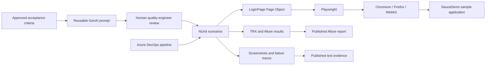

# AI-Accelerated Quality Engineering Blueprint

🚀 A client-demo POC showing how browser automation, risk-based test design, CI/CD, and human-reviewed GenAI assistance can work together in a quality engineering workflow.

> **POC scope:** This repository exercises the public SauceDemo sample application. It demonstrates an approach, not measured customer time savings or a production-ready test platform. Adapt the URL, selectors, data, and controls before using it with a client application.

## Why this approach

Legacy regression cycles can delay feedback and releases. This blueprint demonstrates a shift of repeatable checks into browser automation, with CI feedback and reusable test-design prompts to help teams review quality risks earlier.

The POC demonstrates:

- ✅ Repeatable positive and negative login checks in Chromium, Firefox, and WebKit.
- ⚡ CI feedback with TRX results and Allure reports.
- 🔎 Per-test screenshots, plus Playwright traces on failures, to speed up triage.
- 🧠 A reusable GenAI prompt for drafting scenarios, with explicit human review and no runtime AI dependency.

No time-to-market or coverage improvement is claimed as a measured result; quantify those outcomes against a client baseline during a pilot.

### Sample report

The committed snapshot below shows the Allure report for the two passing WebKit login scenarios. Each CI browser job publishes its own report and evidence artifacts.


## Tech stack

| Technology | Role |
|---|---|
| C# / .NET 8 | Test implementation and shared framework utilities |
| Microsoft Playwright | Browser automation and trace capture |
| NUnit | Test organization and execution |
| Azure DevOps Pipelines | CI/CD and browser-matrix execution |
| Allure | Test reports, metadata, and evidence attachments |
| GenAI prompt | Human-reviewed candidate test-scenario design |

## Architecture



### Design highlights

- **Page Object Model:** [LoginPage.cs](./src/pages/LoginPage.cs) keeps SauceDemo navigation and login selectors out of test assertions.
- **Test settings:** [TestSettings.cs](./src/utils/TestSettings.cs) centralizes browser selection, artifact output, and safe filenames.
- **Risk-focused examples:** [LoginTests.cs](./src/tests/LoginTests.cs) covers successful sign-in and the locked-out-user behavior.
- **AI-assisted planning:** [login-scenario-generation.md](./ai-prompts/login-scenario-generation.md) includes a reusable prompt, illustrative scenarios, and a review checklist. It does not call an AI service or generate code in CI.
- **Failure diagnostics:** Each test attaches a screenshot to NUnit/Allure results. Failed tests also save a Playwright trace ZIP for Trace Viewer.

## Repository structure

```text
ai-prompts/
  login-scenario-generation.md   # Reusable, human-reviewed scenario prompt
docs/
  assets/
    allure-demo.png              # Sample Allure report screenshot
pipelines/
  azure-pipelines.yml            # Build, cross-browser tests, reports, artifacts
src/
  pages/
    LoginPage.cs                 # SauceDemo Page Object
  tests/
    AI.Driven.QE.Framework.Tests.csproj
    LoginTests.cs
    allureConfig.json
  utils/
    TestSettings.cs              # Browser and evidence settings
```

## Run locally

### Prerequisites

- .NET 8 SDK and runtime
- PowerShell (`pwsh`) for Playwright's browser installer
- Internet access to SauceDemo
- Node.js/npm and Java 17+ if generating an Allure HTML report locally

Clone the repository and restore/build the test project:

```bash
git clone https://github.com/aeromodeller/AI-Driven-QE-Framework.git
cd AI-Driven-QE-Framework
dotnet restore src/tests/AI.Driven.QE.Framework.Tests.csproj
dotnet build src/tests/AI.Driven.QE.Framework.Tests.csproj --configuration Release
```

Install Chromium for the default local run:

```bash
pwsh src/tests/bin/Release/net8.0/playwright.ps1 install chromium
```

Run the suite and save screenshots under the repository's `test-artifacts/` directory:

```bash
export QE_ARTIFACTS_DIR="$PWD/test-artifacts"
dotnet test src/tests/AI.Driven.QE.Framework.Tests.csproj --configuration Release
```

To run another browser locally, install it and select it through `PLAYWRIGHT_BROWSER`:

```bash
pwsh src/tests/bin/Release/net8.0/playwright.ps1 install firefox webkit
PLAYWRIGHT_BROWSER=firefox dotnet test src/tests/AI.Driven.QE.Framework.Tests.csproj --configuration Release
PLAYWRIGHT_BROWSER=webkit dotnet test src/tests/AI.Driven.QE.Framework.Tests.csproj --configuration Release
```

The suite uses SauceDemo's public demonstration accounts: `standard_user` and `locked_out_user`, both with the demo password `secret_sauce`. Do not reuse these credentials for other systems. The success test verifies the Products inventory route; the negative test checks the locked-out error.

### View reports and failure evidence

The NUnit/Allure results are written under `src/tests/bin/Release/net8.0/allure-results`. Generate an HTML report after running tests:

```bash
npm install --global allure-commandline@2.46.1
allure generate src/tests/bin/Release/net8.0/allure-results --clean --output allure-report
allure open allure-report
```

Screenshots are saved to `test-artifacts/` locally and attached to the test results. Failed tests also save a `*-trace.zip`; open it with Playwright's Trace Viewer:

```bash
pwsh src/tests/bin/Release/net8.0/playwright.ps1 show-trace test-artifacts/<test-name>-chromium-trace.zip
```

## Azure DevOps

Create a pipeline using [azure-pipelines.yml](./pipelines/azure-pipelines.yml). It builds the .NET 8 test project and runs a Chromium/Firefox/WebKit matrix. Each browser job publishes:

- NUnit TRX test results.
- Raw Allure results and a generated HTML Allure report.
- Per-test screenshots and failure traces.

The YAML is a repository template; validate it in your Azure DevOps organization and enable the required pipeline permissions before the client demo. The sample target is an external public demo site, so results depend on its availability and network access.

## Client-pilot considerations

Before adapting this POC to a client application, agree on authorized environments and test data, replace the sample URL and selectors, store credentials in an approved secret manager, and confirm data retention/access policies for screenshots and traces. Add a client-specific baseline before presenting ROI or time-to-market claims.
